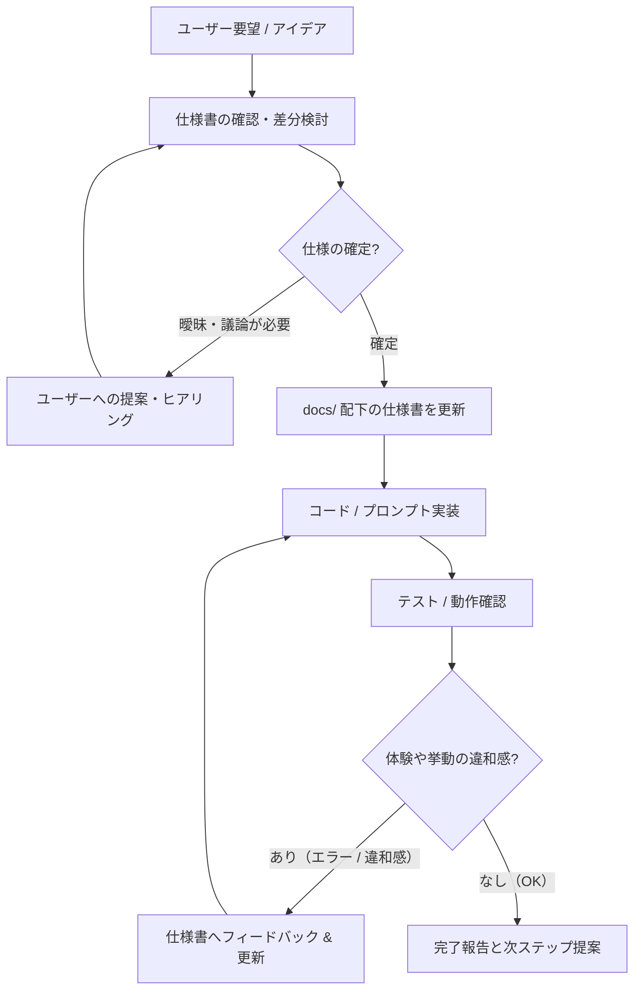

# AGENTS.md - 開発運用ガイドライン（SDD運用規約）

本プロジェクトは **SDD (Spec-Driven Development / 仕様駆動開発)** に則り開発を進行します。
本ドキュメントは、本リポジトリで作業するすべてのAIエージェントおよび開発者が遵守すべき原則と運用手順を定めます。

---

## 1. 開発の基本思想：柔軟な仕様駆動開発（Agile-SDD）

本プロダクトは初期段階であり、**「完全なウォーターフォールではなく、トライアンドエラーとフィードバックループを回しながら仕様を育てていく」** 方式を採用します。

### 原則
1. **Single Source of Truth (SSOT)**:
   - すべてのコード・プロンプト・ロジックの正本は `docs/` 配下の仕様書である。
2. **仕様先行（Spec First）**:
   - 新規機能追加や振る舞いの変更を行う際は、**必ず先に仕様書を更新・合意**してからコードに反映する。
3. **柔軟な変更と履歴管理（Living Documentation）**:
   - トライアンドエラーで「作ってみて違和感があった」「プロンプトの効きが悪かった」場合は、実装側で勝手にねじ曲げず、即座に仕様書側へフィードバックして仕様を更新する。
4. **段階的検証（MVP First）**:
   - 完璧な巨大システムを一度に作らず、コア体験（対話の寄り添い感・地雷回避・VOD誠実案内）を最小単位でプロトタイピングして検証する。

---

## 2. ディレクトリ構造と責務

```text
/ (project root)
├── AGENTS.md                       # 本開発ガイドライン
├── docs/                           # 仕様書ディレクトリ（SSOT）
│   ├── product_concept.md          # サービス理念・コアバリュー・全体設計
│   ├── characters_spec.md          # 6人のキャラクター詳細定義・プロンプト指針
│   ├── conversation_flow_spec.md   # 対話・感情抽出・UI/UXフロー
│   ├── vod_and_availability_spec.md# 配信判定・入手性・誠実案内ロジック
│   ├── safety_and_guardrails_spec.md# メンタルセーフティ・地雷トリガー除外仕様
│   ├── tech_architecture_spec.md   # 技術選定・API構成・アーキテクチャ
│   └── roadmap.md                  # 検証フェーズ・タスク進捗
├── src/                            # アプリケーションソースコード（開発開始後）
└── tests/                          # 自動テスト・プロンプト評価スクリプト
```

---

## 3. エージェントの作業フロー（ワークフロー）

作業を行う際は、必ず以下のステップを遵守すること。



1. **Step 1: 要件の確認と仕様差分の検討**
   - 変更がどの仕様書（`docs/`）に影響するかを特定する。
2. **Step 2: 仕様書の先行更新**
   - 仕様変更の背景・理由を明確にし、関連する `docs/*.md` を編集する。
3. **Step 3: 実装と検証**
   - 仕様書の内容に忠実にコードやプロンプトを実装する。
4. **Step 4: 仕様との整合性チェック**
   - 実装と仕様書に乖離がないか検証する。乖離が見つかった場合は仕様書側または実装側を同期する。

---

## 4. プロンプト・キャラクター対話の品質基準

- **弱ったユーザーへの心理的安全性**:
   - 説教・過度な正論・押し付けは厳禁。
   - 長文の壁を作らない（1吹き出し 100〜150字程度）。
- **誠実性の担保**:
   - アフィリエイト誘導・無理なサブスク契約を推奨しない。
   - 入手困難・高騰時は明確にストップをかける。
- **地雷トリガーの徹底排除**:
   - ユーザーが抱えている傷口（いじめ、ブラック労働、毒親等）を刺激する描写が含まれる作品は、どんな名作であっても推薦候補から除外する。
