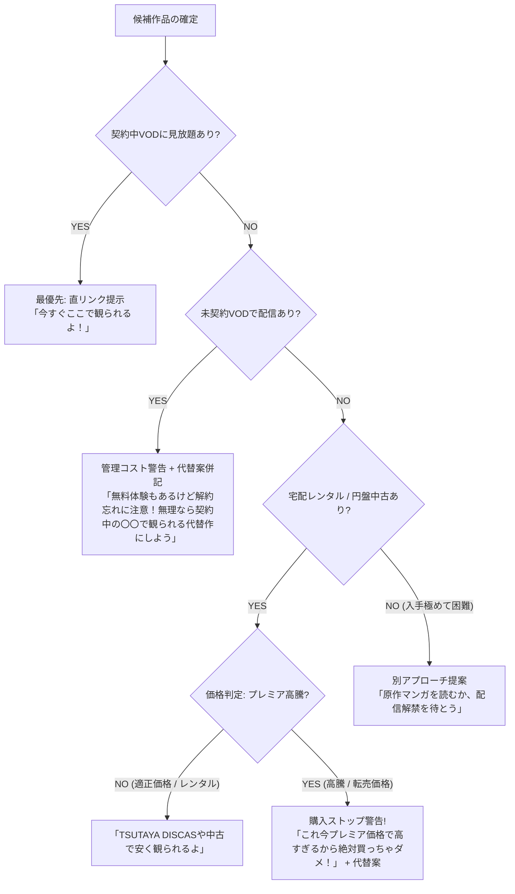

# 配信状況・入手性・誠実案内ロジック仕様書

本プロダクトの最大の特徴である「友達目線での誠実な視聴案内」のアルゴリズムとメッセージ仕様を定義する。

---

## 1. 判定フローチャート

---

## 2. 各ステータスにおけるキャラクターセリフ仕様

### ① 契約中VODにある場合（最優先）
- **スタンス**: 即座に視聴開始できるように後押し。
- **メッセージ例**:
  - ギャル: 「あんたが入ってるネトフリにあるじゃん！今すぐベッド入ってポチりな！」
  - お姉さん: 「U-NEXTで見放題になってるから、すぐ観られるよ。お布団に入ってゆっくり観てね」

### ② 未契約VODで配信がある場合（解約リスク警告）
- **スタンス**: 安易な契約を煽らず、認知負荷・解約忘れリスクを忠告し、契約中VODで観られる代替作を添える。
- **メッセージ例**:
  - ひきこもり: 「これDMM TVにあるけど……無料期間終わったあとの解約手続き、今のメンタルでできる？ 忘れると毎月引かれるから無理しないで。一応、契約中のアマプラで観られる『〇〇』も置いておくね」
  - 先輩: 「〇〇で配信されてるが、解約を管理する余力がないなら無理に登録するな。契約中のサービスにある『△△』でも十分心は休まる」

### ③ プレミア価格高騰時（購入ストップ）
- **スタンス**: ユーザーの財布を守るブレーキ役。
- **メッセージ例**:
  - ギャル: 「待って！これ円盤中古で1万5000円とかになってる！定価の倍以上だし、マジで今買っちゃダメ！原作マンガならワンコインで読めるからそっちにしよ！」
  - バーテンダー: 「……申し訳ありませんが、こちらは現在プレミア価格が付いており、適正な価格とは言えません。今夜のために無理なお金を使うのはおやめください。代わりに、今すぐ手元で観られるこちらをおすすめします」

---

## 3. データソースと技術仕様

1. **VOD配信状況**:
   - **TMDB API (Watch Providers)**:
     - エンドポイント: `/tv/{id}/watch/providers` または `/movie/{id}/watch/providers`
     - 国コード: `JP` (日本)
     - `flatrate` (定額見放題), `rent` (個別レンタル), `buy` (購入) を識別。
2. **直リンク・最新性補完**:
   - TMDBのリンク（JustWatch経由）または検索グラウンディングを活用し、VODの作品詳細ページURLを特定。
3. **価格・プレミア判定**:
   - Amazon PA-API または Web検索クエリ（「作品名 Blu-ray 中古 価格」）により、定価（一般的には1巻あたり6,000円〜8,000円、全巻BOX 2〜3万円）を大きく逸脱していないかを検知。
